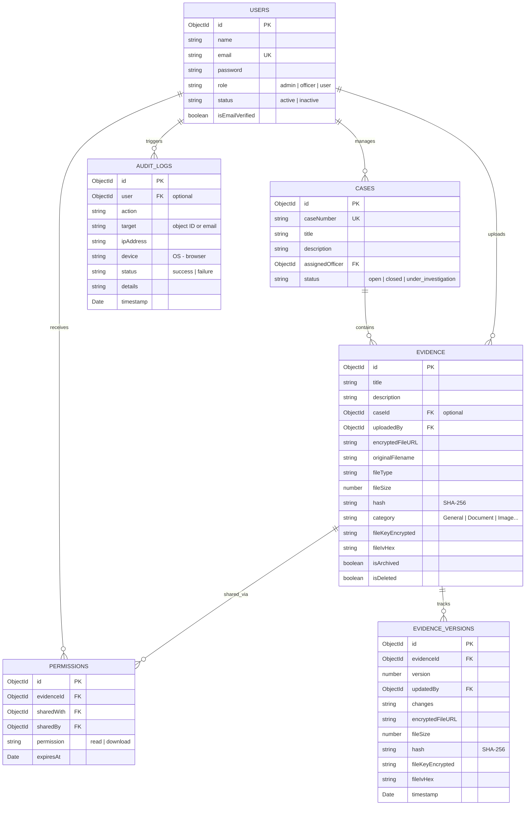

# CivicEvidence – Secure Digital Evidence Management System (DEMS)

CivicEvidence is a portfolio-worthy, secure, cloud-ready Digital Evidence Management System designed for law enforcement agencies, private investigation teams, and legal departments. It enables investigators to upload, encrypt, share, track, and audit digital evidence while maintaining an immutable, tamper-proof chain of custody.

---

## 🛡️ Core Security Architecture & Protocols

1. **End-to-End File Encryption (AES-256-CBC)**
   - Every file undergoes encryption **in-memory** in the backend before disk serialization or S3 upload. No unencrypted files are ever written to persistent storage.
   - A unique, cryptographically random key is generated for every evidence file.
   - File-specific keys are encrypted using a global `MASTER_ENCRYPTION_KEY` (AES-256-CBC envelope encryption) and stored in the MongoDB metadata record.

2. **Immutable Chain of Custody & Audit Logging**
   - Every view, upload, download, permission change, rollback, and authentication event generates a permanent log.
   - Captures actor identity, IP address, OS and browser signature, timestamp, and success/failure outcome.

3. **Granular Access Control (RBAC)**
   - **Administrators**: Control approvals, assign investigator roles, toggle statuses, view full system audit trails, and restore deleted files.
   - **Investigation Officers**: Create cases, link files to cases, upload new versions, share links, and request access.
   - **Standard Users**: Can only view files they personally uploaded or files explicitly shared with them.

4. **Security Hardening**
   - **Helmet**: Secures HTTP response headers.
   - **Express-Rate-Limit**: Defends authentication paths against brute-force attacks.
   - **JWT + Secure Cookies/Headers**: Manages sessions.
   - **SHA-256 Hash Auditing**: Every download performs a hash verification against the upload hash to guarantee file integrity.

---

## 🏗️ Folder Structure

```
civicevidence/
├── backend/
│   ├── config/            # DB configuration
│   ├── controllers/       # Business logic (Auth, Evidence, Cases, Shares, Analytics)
│   ├── middleware/        # JWT Authentication, Access guards
│   ├── models/            # Mongoose MongoDB collections schemas
│   ├── routes/            # REST API endpoints
│   ├── services/          # AES Encryption service, S3/Local Storage drivers
│   ├── utils/             # Audit logger utility
│   ├── uploads/           # Secure local storage fallback directory
│   ├── server.js          # Express entrypoint
│   └── test-backend.js    # Dry-run integration validation test
├── frontend/
│   ├── src/
│   │   ├── components/    # Reusable Sidebars, Navbars, Protection guards
│   │   ├── context/       # React Contexts (Authentication state, CSS theme toggles)
│   │   ├── layouts/       # Main Dashboard shell layouts
│   │   ├── pages/         # Login, Register, Dashboards, Cases, Audits, Analytics
│   │   ├── services/      # Axios API interceptors
│   │   ├── App.jsx        # Main routing table
│   │   └── index.css      # Design tokens (Glassmorphic variables, dark/light theme CSS)
│   ├── vite.config.js     # Dev server setups
│   └── package.json       # React dependencies config
└── README.md              # System documentation
```

---

## 📊 Database Collection Models (ERD)



---

## 🚀 API Documentation Reference

### 🔐 Authentication Module (`/api/auth`)
* `POST /register`: Registers a new account. The first registered user is automatically created as an active Admin to boot the system. Subsequent accounts are pending Admin approval.
* `POST /login`: Log in and receive JWT and Refresh Token.
* `POST /verify-email`: Confirm verification OTP.
* `POST /forgot-password`: Requests a password reset code.
* `POST /reset-password`: Resets credentials with OTP validation.
* `POST /logout`: Sign out and logs event.

### 📁 Evidence Module (`/api/evidence`)
* `GET /`: Lists evidence metadata (filtered, paginated). Visible tiers adapt to roles.
* `GET /:id`: Details of a specific evidence dossier.
* `POST /`: Uploads a file (multipart form data). Encrypts file buffer in-memory and saves key metadata.
* `GET /:id/download`: Checks authorization, retrieves, decrypts, and downloads file.
* `PUT /:id`: Updates metadata or uploads a new version of the file (generates a version history record).
* `DELETE /:id`: Soft-deletes a file.
* `POST /:id/restore`: Restores soft-deleted items (Admin only).
* `POST /:id/rollback`: Rolls back to a previous file version.

### 💼 Case Module (`/api/cases`)
* `GET /`: Fetch investigation directories.
* `POST /`: Create case directories (Officer/Admin only).
* `GET /:id`: Case dossier metadata and associated files.
* `PUT /:id`: Modify status (Open, Closed, Under Investigation).

### 🤝 File Sharing (`/api/share`)
* `POST /`: Create secure temporary sharing access records (with expirations).
* `GET /`: View current active shared file links.
* `DELETE /:id`: Revoke sharing permissions instantly.

---

## 🛠️ Local Installation & Verification Guide

### Prerequisites
- Node.js (v18+)
- MongoDB running locally on `mongodb://localhost:27017`

### Step 1: Clone and Configuration
Create a `.env` file in `backend/`:
```env
PORT=5001
MONGODB_URI=mongodb://localhost:27017/civicevidence
JWT_SECRET=supersecretjwttokenkeyfordigital evidenciassystem
JWT_REFRESH_SECRET=anotherrefreshsupersecretkeyforcivicevidence
MASTER_ENCRYPTION_KEY=d3c1264c126d4050a4e7ab56f8cd5a19cb2d2c1e85f0b5d9284cfdbe9a8cf67b
STORAGE_MODE=local
```

### Step 2: Set Up Backend
```bash
cd backend
npm install
node server.js
```
The backend server will launch on port `5001`.

### Step 3: Run Backend Integration Dry-Run
```bash
cd backend
node test-backend.js
```
This script tests database connection, user registration, AES-256 file encryption, storage paths, file decryption, and SHA-256 hash checks.

### Step 4: Set Up Frontend
```bash
cd ../frontend
npm install
npm run dev
```
The React development server will start on `http://localhost:5174`.

### Step 5: Verification Flow
1. Open `http://localhost:5174/register`.
2. Register an Admin account (first account will be auto-approved).
3. Log in. Go to the dashboard.
4. Navigate to **Evidence Files**, click **Upload payload**, select a document, and upload.
5. In **Evidence Files**, download the file. The file is fetched, decrypted, verified via SHA-256, and downloaded.
6. Verify under **Audit Trail** that all operations are logged.
